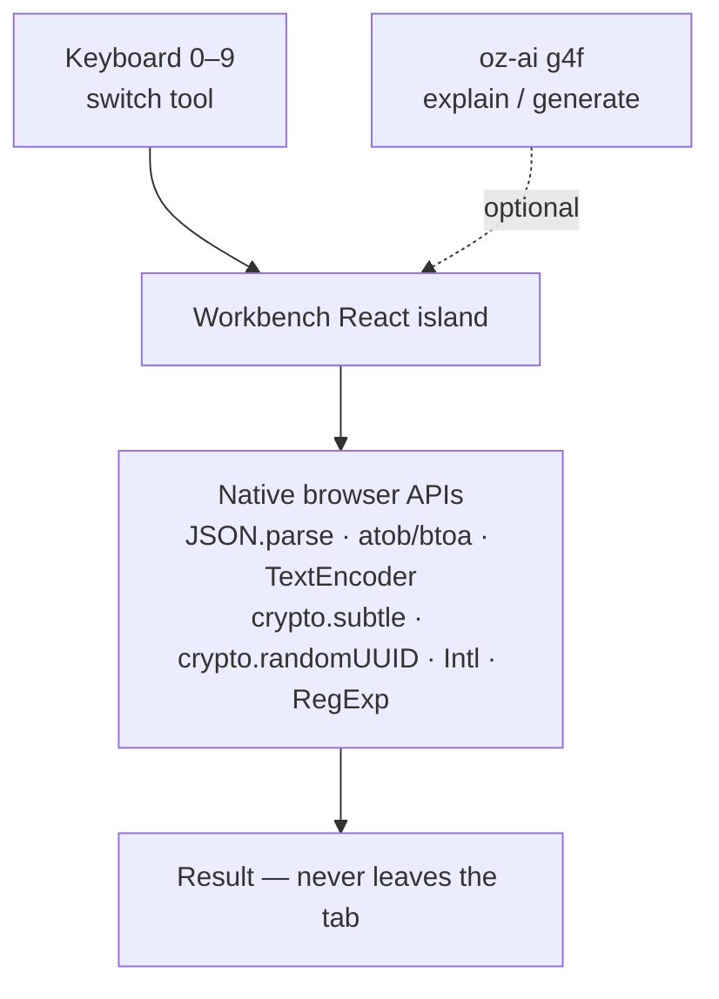

# oriz·dev — developer multitool

> A keyboard-first "terminal" for everyday dev chores — ten tools, one page, zero servers. Press 0–9 to switch.

[](LICENSE)
[](https://github.com/chirag127/oriz-dev/stargazers)
[](https://github.com/chirag127/oriz-dev/commits)
[](https://astro.build)

**Live app:** https://dev.oriz.in · **GHP landing:** https://chirag127.github.io/oriz-dev/ · **Repo:** https://github.com/chirag127/oriz-dev

If this is useful, please ⭐ [star the repo](https://github.com/chirag127/oriz-dev) — it helps others find it.

**100% client-side — no upload, no signup, no key, free.** Every byte you paste stays in your browser tab.

## How it works



## Tools

| # | tool | what it does |
|---|------|--------------|
| 1 | **JSON** | format · validate · minify (native `JSON.parse`) |
| 2 | **Base64** | UTF-8-safe encode / decode |
| 3 | **JWT** | decode header + payload, exp check (no signature secret sent) |
| 4 | **URL** | encode / decode components |
| 5 | **UUID** | crypto v4, bulk generate |
| 6 | **Timestamp** | epoch ⇄ ISO ⇄ local, live clock, relative time |
| 7 | **Cron** | explain a 5-field schedule in plain English |
| 8 | **Hash** | SHA-1/256/384/512 over text or a dropped file (`crypto.subtle`) |
| 9 | **Diff** | line-level LCS diff with +/- stats |
| 0 | **Regex** | live tester (matches, groups, highlight) + AI-generate from a description |

Press **0–9** to switch tools.

## AI (optional polish)

Explain a regex / JWT payload / cron expression, or generate a regex from a description — powered by the shared [`@chirag127/oz-ai`](https://github.com/chirag127/design-system) package (wraps **g4f / gpt4free** with multi-provider failover, no API key). If every provider is down, the core tools still work; AI is never required.

## Privacy

Nothing is uploaded. All parsing, hashing, and diffing runs locally with native browser APIs (`JSON.parse`, `atob`/`btoa`, `TextEncoder`, `crypto.subtle`, `crypto.randomUUID`, `Intl`, `RegExp`). Heavy code paths lazy-load only on use.

## Tech stack

- **Astro 6** (static output) + small **React 19** islands
- **Tailwind CSS v4** via `@tailwindcss/vite`
- **@vite-pwa/astro** for the installable PWA
- Shared `@chirag127/oz-*` packages: `oz-ai`, `oz-file`, `oz-tokens-base`, `oz-chrome`
- Deployed on **Cloudflare Pages**; the GHP landing is served from GitHub Pages

## Repo structure

```
oriz-dev/
├── src/
│   ├── components/Workbench.tsx   # main React island — tool switcher + panes
│   ├── components/AiExplain.tsx   # optional oz-ai explain/generate widget
│   ├── lib/tools.ts               # pure logic: JSON/Base64/URL/JWT/UUID/…
│   ├── lib/cron.ts                # 5-field cron → plain English
│   ├── lib/hash.ts                # crypto.subtle hashing
│   ├── layouts/Base.astro         # page shell (oz-chrome)
│   ├── pages/index.astro          # single-page entry
│   └── styles/theme.css           # --oz-* token overrides
├── astro.config.mjs
├── tests/                         # vitest — pure tool logic
└── package.json
```

## Quick start

```bash
npm install --legacy-peer-deps
npm run dev      # local
npm run test     # vitest — pure logic
npm run build    # static dist/
npm run deploy   # build + wrangler pages deploy
```

## Configuration

No configuration required — the app is fully client-side. The optional AI feature uses the keyless `@chirag127/oz-ai` g4f client (no API key, no env vars).

## Part of the oriz family

oriz-dev is one of ~80 small, single-purpose tools in the [oriz](https://blog.oriz.in) family — each doing one thing well and running **$0 on the Cloudflare free tier**. Start at the hub, [oriz-home](https://oriz.in), or try a sibling like [oriz-md](https://md.oriz.in) (Markdown studio) or [oriz-qr](https://qr.oriz.in) (QR studio).

## Contributing

Issues and PRs welcome. Keep it client-side and dependency-light; each tool's logic lives in `src/lib` with a vitest case. Conventional commits are the changelog.

## Status

Stable and live at https://dev.oriz.in.

## License

MIT © Chirag Singhal — chirag@oriz.in
